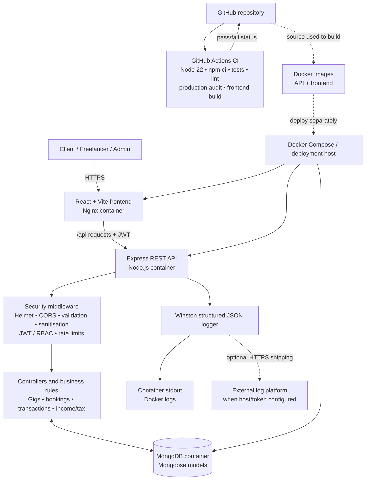
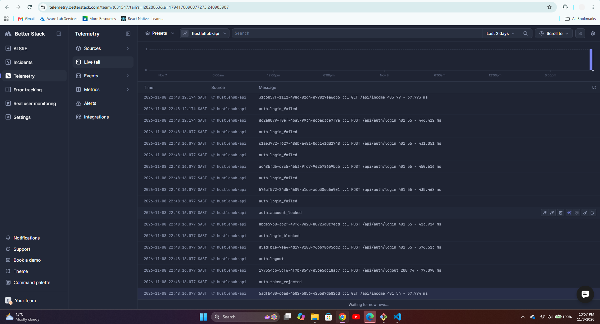
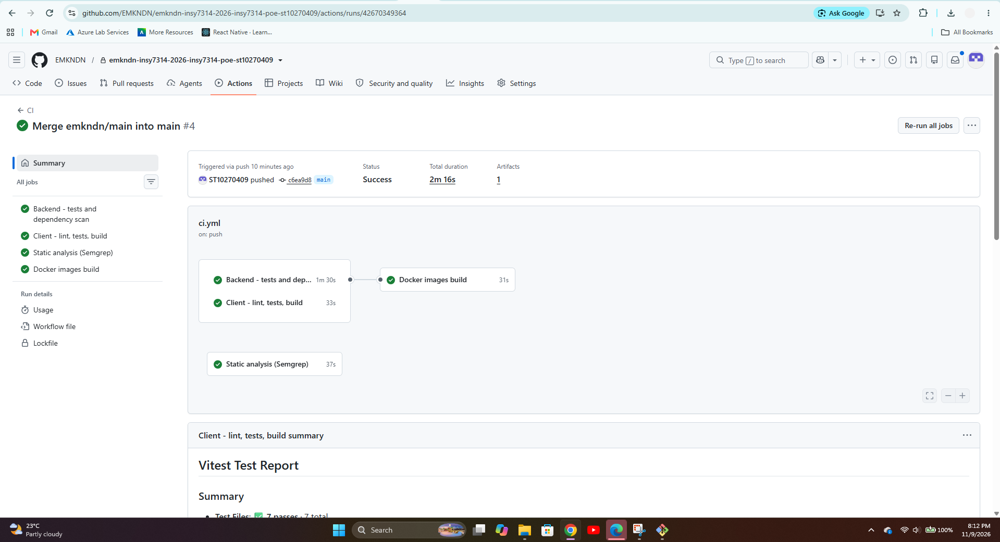
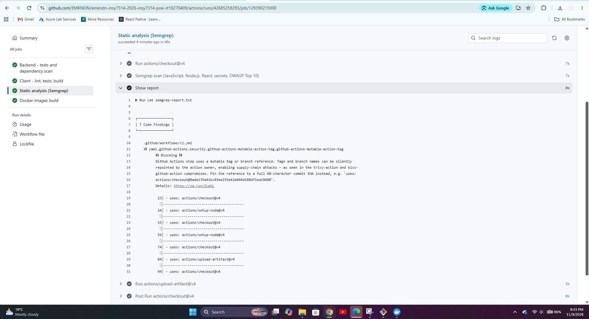

# HustleHub+ — Secure Freelance Marketplace Platform

**Modules:** INSY7314/w and APDS7311/w
**Student:** Lonwabo Gumede, Ayabonga Nzuza, Luke James Lutchmiah, Nonjabulo Mathenjwa
**Parts:** 1 — Secure Foundations; 2 — Secure Stack; 3 — DevSecOps, Monitoring and Finalisation

**Part 3 demonstration video:** [HustleHub+ Part 3 walkthrough](REPLACE-WITH-PART-3-VIDEO-LINK)  
**Run everything with Docker:** see [section 17.3](#173-docker-compose-local-demonstration)  
**CI pipeline, static analysis and evidence:** see [section 24E](#24e-continuous-integration-and-deployment-notes)

## Table of Contents

1. [System Overview](#1-system-overview)
2. [Intended Users](#2-intended-users)
3. [Backend Architecture](#3-backend-architecture)
4. [Project Structure](#4-project-structure)
5. [API Routes](#5-api-routes)
6. [Password Security and Hashing](#6-password-security-and-hashing)
7. [JWT-Based Authentication](#7-jwt-based-authentication)
8. [JWT Protection of Routes](#8-jwt-protection-of-routes)
9. [Input Validation](#9-input-validation)
10. [Request Size Protection](#10-request-size-protection)
11. [HTTPS Configuration](#11-https-configuration)
12. [Security Headers and CORS](#12-security-headers-and-cors)
13. [Controlled Error Handling](#13-controlled-error-handling)
14. [Authentication Error Protection](#14-authentication-error-protection)
15. [Environment and Secret Management](#15-environment-and-secret-management)
16. [Threat Notes](#16-threat-notes)
17. [Setup and Running Locally](#17-setup-and-running-locally)
18. [Windows / Git Bash Troubleshooting](#18-windows--git-bash-troubleshooting)
19. [Postman Testing](#19-postman-testing)
20. [Postman Test Results](#20-postman-test-results)
20A. [Part 2 Automated Testing](#20a-part-2-testing-backend-newman-and-frontend)
21. [API Response Format](#21-api-response-format)
22. [Why 12 Bcrypt Salt Rounds?](#22-why-12-bcrypt-salt-rounds)
23. [Dependency Advisories](#23-dependency-advisories)
24. [Roadmap and Part 3 Status](#24-roadmap)
24A. [Income and Tax Estimation](#24a-income-and-tax-estimation)
24B. [Additional Security Features](#24b-additional-security-features)
24C. [Logging and Monitoring](#24c-logging-and-monitoring)
24D. [Final Security Review](#24d-final-security-review)
24E. [Continuous Integration and Deployment Notes](#24e-continuous-integration-and-deployment-notes)
25. [Academic Security Conclusion](#25-academic-security-conclusion)
26. [Team Contributions](#26-part-2-team-contributions)
27. [AI Disclosure](#ai-disclosure)
28. [Submission Checklists](#part-1-submission-checklist)
29. [References](#references)

---

## 1. System Overview

HustleHub+ is a secure freelance marketplace that connects two primary types of users:

* **Freelancers** — advertise services ("gigs"), manage bookings, and track income and estimated tax obligations.
* **Clients** — browse available gigs and book the services they need.

A third role, **Admin**, oversees the platform: in Part 2 admins can list users and remove any gig. Admin accounts cannot be self-assigned through public registration; they are created with the `seed:admin` script.

Because HustleHub+ processes sensitive information such as passwords, authentication credentials, booking and transaction records, and income-related information, security is treated as a fundamental design requirement from Part 1 rather than as a feature added later.

Part 1 delivered the secure backend foundation: Node.js and Express REST endpoints for registration, authentication, and access to authenticated user information, backed by an in-memory user store as permitted by the POE brief.

**Part 2 (Secure Stack)** turns that foundation into a full-stack marketplace. User data is now persisted in **MongoDB through Mongoose**; freelancers create and manage their own gigs; clients browse and request bookings; a simulated transaction is recorded only when a freelancer approves a request; each freelancer's income is tracked from their own transactions; and a React frontend consumes the API. Role-based access control, input sanitisation, rate limiting and a Content Security Policy were added across the backend. See sections 5, 12, 16, 17, 19 and 26.

The backend includes:

* Password hashing using `bcryptjs`
* JWT-based authentication
* HTTPS using a locally generated development certificate
* Server-side input validation using `express-validator`
* Security headers using `helmet`
* Request body-size limits
* Environment-based secret management
* Centralised and controlled error handling
* Protected routes using reusable authentication middleware
* Postman tests covering successful and invalid scenarios

Part 2 now includes income and tax estimation, Docker containerisation, structured logging, additional security controls and a final security review. A GitHub Actions continuous-integration workflow runs backend and frontend quality checks; deployment remains a separate operational step.

---

## 2. Intended Users

HustleHub+ is designed around the following marketplace roles.

### 2.1 Clients

Clients use the platform to:

* Browse available freelance services
* View freelancer offerings
* Book services
* View their bookings and transaction records; cancel a request while it is still pending

The `client` role is available through the public registration endpoint.

### 2.2 Freelancers

Freelancers use the platform to:

* Advertise services as gigs
* Manage bookings
* Review booking requests and approve or reject pending work
* Track gross income, estimated tax, net income and monthly income trends
* Review booking counts by status

The `freelancer` role is available through the public registration endpoint. Freelancers can review incoming booking requests and approve or reject pending requests.

### 2.3 Admin

An administrator role is enforced by the backend for privileged platform management. In Part 2 admins can list users (`GET /api/admin/users`) and remove any gig (`DELETE /api/admin/gigs/:id`). Admins are created only through the seed script.

Admin cannot be selected during public registration. The registration validator only permits:

* `client`
* `freelancer`

This prevents an unauthenticated user from simply assigning themselves an elevated role.

---

## 3. Backend Architecture

HustleHub+ follows the **MERN** architecture: MongoDB, Express, React, and Node.js.

In Part 1 the data-access layer was an in-memory store that followed a Mongoose-shaped interface. In Part 2 it was replaced by **MongoDB/Mongoose models** (`src/models`), and a **React frontend** (`client/`) was added. The architecture below shows the complete Part 2 application, its Docker runtime, GitHub Actions quality pipeline and structured logging destinations.

### 3.1 System Architecture Diagram



**Deployment note:** Docker Compose defines the local multi-container runtime. The GitHub Actions workflow in `.github/workflows/ci.yml` performs continuous integration (tests, linting, build and production dependency audits). It does not automatically publish images or deploy to a hosting provider; deployment is a separate step and must be configured for the chosen host.

### 3.2 Request Processing Flow

A controlled processing sequence is followed when a request is submitted to the HustleHub+ backend, using Express routing and middleware (Express.js, n.d.-a, n.d.-b, n.d.-c).

For general requests:

```text
Client / Postman
       ↓
HTTPS / TLS
       ↓
Helmet / CORS / Body-size limits
       ↓
Express Router
       ↓
Input Validation
       ↓
Controller
       ↓
Data Store
       ↓
Controlled JSON Response
```

For protected routes, JWT authentication is inserted before the controller:

```text
Client / Postman
       ↓
HTTPS / TLS
       ↓
Security and request middleware
       ↓
Express Router
       ↓
Input Validation
       ↓
JWT Authentication Middleware
       ↓
Controller
       ↓
Data Store
       ↓
Controlled JSON Response
```

Invalid requests are rejected before they reach the controller. Authentication failures are rejected by the JWT middleware before protected business logic is executed.

**Part 2 request path.** The middleware order in `src/app.js` is now:

```text
HTTPS / TLS
   ↓
Helmet (incl. Content-Security-Policy, HSTS)
   ↓
CORS (allow-list of frontend origin(s))
   ↓
Body parser with 10 KB limit
   ↓
Sanitisation (NoSQL operator stripping + XSS cleaning)
   ↓
Rate limiting (global on /api; stricter on auth and booking)
   ↓
Express Router
   ↓
Input validation (express-validator)  →  400 on failure
   ↓
JWT authentication  →  401 on failure
   ↓
Role check (authorize)  →  403 on failure
   ↓
Controller (ownership check, role-scoped query)  →  403 / 404
   ↓
MongoDB (Mongoose)
   ↓
Controlled JSON response / central error handler
```

Validation failures are returned directly by `validateRequest`; errors thrown inside controllers or middleware are mapped to fixed generic messages by the central error handler.

### 3.3 Component Summary

| Layer              | Technology                                       | Responsibility                                            |
| ------------------ | ------------------------------------------------ | --------------------------------------------------------- |
| Transport          | Node.js `https` module + self-signed certificate | Encrypts traffic between client and server                |
| Security headers   | `helmet`                                         | Applies protective HTTP security headers                  |
| CORS               | `cors`                                           | Controls cross-origin requests                            |
| Request protection | Express body-parser limits                       | Restricts request body size                               |
| Input validation   | `express-validator`                              | Validates user-supplied data before controller processing |
| Authentication     | `jsonwebtoken`                                   | Creates and verifies signed JWTs                          |
| Password security  | `bcryptjs`                                       | Hashes and compares passwords                             |
| Routing            | Express Router                                   | Separates authentication, marketplace and admin routes    |
| Authorisation      | `authorize(...roles)` + controller ownership checks | Enforces role-based access and per-record ownership    |
| Sanitisation       | `express-mongo-sanitize`, `xss`                  | Strips NoSQL operators and HTML/script from free text     |
| Rate limiting      | `express-rate-limit`                             | Throttles authentication, booking and general API traffic |
| Data               | MongoDB via Mongoose (`src/models`)              | Persists users, gigs, bookings and transactions           |
| Frontend           | React, Vite, React Router, Tailwind (`client/`)  | User interface; calls the API through a dev proxy         |
| Error handling     | Centralised middleware                           | Provides safe and consistent error responses              |

---

## 4. Project Structure

```text
NALL_HustleHub/
├── .github/workflows/ci.yml     GitHub Actions pipeline (tests, Newman, audit, Semgrep, Docker build)
├── docker-compose.yml           Orchestrates MongoDB, the API and the client
├── backend/
│   ├── Dockerfile               API image (Node 20, non-root user)
│   ├── certs/
│   │   └── generate-cert.sh
│   ├── docs/                    api-contract-part3.md, frontend-csp-recommendation.md,
│   │   │                        readme-sections/, newman-part2-output.txt
│   │   └── evidence/            screenshots: logging platform, pipeline, Newman, Semgrep, Docker, app
│   ├── postman/
│   │   ├── HustleHub-Part1.postman_collection.json
│   │   └── HustleHub-Part2.postman_collection.json
│   ├── src/
│   │   ├── config/        env.js, db.js, taxTables.js
│   │   ├── controllers/   authController, gigController, bookingController,
│   │   │                  incomeController, adminController
│   │   ├── middleware/    authenticate, authorize, validateRequest, sanitize,
│   │   │                  rateLimiter, errorHandler, requestId
│   │   ├── models/        User, Gig, Booking, Transaction, RevokedToken, cleanJson
│   │   ├── routes/        auth, user, gig, booking, transaction, income, admin
│   │   ├── scripts/       seedAdmin.js
│   │   ├── utils/         validators.js, taxEngine.js, logger.js
│   │   ├── app.js
│   │   └── server.js
│   ├── tests/             Jest + Supertest suites and tests/support (in-memory model fakes)
│   ├── .env.example
│   └── package.json
├── client/                React frontend (Vite, Tailwind, Vitest)
│   ├── Dockerfile         multi-stage build served by unprivileged nginx
│   └── nginx.conf         security headers and /api proxy to the API container
├── .env.docker.example    variables for docker compose
├── HustleHub_Part2.postman_collection.json   (frontend/API collection and Newman report)
├── postman-report.html
└── README.md
```

The project follows a layered structure so that routing, controllers, middleware, validation, configuration, and data access have separate responsibilities. This separation improves maintainability and makes individual security controls easier to test and review. In Part 2 the Part 1 in-memory `userStore.js` was removed and replaced by Mongoose models without changing the authentication architecture.

---

## 5. API Routes

### 5.1 Endpoints

| Method | Endpoint | Roles | Purpose |
| ------ | -------- | ----- | ------- |
| GET | `/api/health` | public | Health check |
| POST | `/api/auth/register` | public (rate limited) | Register as `client` or `freelancer`; returns user and JWT |
| POST | `/api/auth/login` | public (rate limited) | Log in; returns user and JWT. Repeated failures lock the account (section 24B) |
| POST | `/api/auth/logout` | any authenticated | Revoke the token used for the request (section 24B) |
| GET | `/api/users/me` | any authenticated | Current user's profile |
| GET | `/api/gigs` | any authenticated | Browse active gigs (`?category=&page=&limit=`) |
| GET | `/api/gigs/mine` | freelancer | The caller's own gigs (any status) |
| GET | `/api/gigs/:id` | any authenticated | One gig (paused gigs visible only to owner/admin) |
| POST | `/api/gigs` | freelancer | Create a gig |
| PUT | `/api/gigs/:id` | freelancer (owner) | Update own gig |
| DELETE | `/api/gigs/:id` | freelancer (owner) | Delete own gig |
| POST | `/api/bookings` | client (rate limited) | Request a gig; creates a **pending** booking (no transaction yet) |
| GET | `/api/bookings` | any authenticated | Role-scoped list: client = own bookings, freelancer = bookings of their gigs, admin = all |
| GET | `/api/bookings/:id` | participants, admin | One booking |
| PATCH | `/api/bookings/:id/approve` | freelancer (gig owner) | Approve a pending booking; creates the simulated transaction exactly once |
| PATCH | `/api/bookings/:id/reject` | freelancer (gig owner) | Reject a pending booking |
| PATCH | `/api/bookings/:id/complete` | freelancer (gig owner) | Mark an approved booking completed |
| PATCH | `/api/bookings/:id/cancel` | client (booking owner) | Cancel a booking while it is still pending |
| GET | `/api/transactions` | any authenticated | Role-scoped list (same scoping as bookings) |
| GET | `/api/income` | freelancer | Total income, pending income, booking status counts and transactions for the caller |
| GET | `/api/income/tax?taxYear=` | freelancer | Estimated tax, monthly breakdown and assumptions (section 24A) |
| GET | `/api/admin/users` | admin | List all users |
| DELETE | `/api/admin/gigs/:id` | admin | Remove any gig |

Public authentication routes are kept separate from protected routes. Authentication is not treated as a one-time event: every protected request must provide valid credentials.

### 5.2 Marketplace features

| Area | Behaviour |
| ---- | --------- |
| Gig management | Freelancers create, view, update and delete **their own** gigs. Any logged-in user can browse active gigs with a category filter and pagination. |
| Bookings | Clients request an active gig. The booking snapshots the gig title and price and remains pending until the freelancer approves or rejects it; clients may cancel while it is pending. |
| Transactions | A transaction (`TXN-…` reference, amount, currency ZAR, status `simulated-paid`) is created when the freelancer approves a pending booking. No payment provider is called, as permitted by the brief. |
| Income tracking | `GET /api/income` returns the freelancer's total income, transaction count and transactions, derived from transactions where they are the freelancer. |
| Admin | Admins can list users and remove any gig. Admin accounts are created by a seed script, never through the public API. |

### 5.3 Role-based access control

| Capability | Client | Freelancer | Admin |
| ---------- | :----: | :--------: | :---: |
| Register / log in | yes | yes | yes (seeded) |
| Browse gigs | yes | yes | yes |
| Create / update / delete gigs | 403 | own only | 403 (may remove via admin route) |
| Book a gig | yes | 403 | 403 |
| View bookings / transactions | own only | own only | all |
| View income | 403 | own only | 403 |
| Admin routes | 403 | 403 | yes |

Enforcement is layered: `authenticate` (valid JWT) → `authorize(...roles)` (role taken from the verified token) → an **ownership check** in the controller for update/delete → **role-scoped queries** for bookings, transactions and income, so one user cannot read another's records. The gig owner, the client on a booking and the freelancer on a transaction always come from the verified JWT or the stored gig, never from the request body. Only whitelisted fields are copied from request bodies (mass-assignment protection), and the transaction amount is copied from the gig's stored price, so a client-supplied `amount` is ignored.

---

## 6. Password Security and Hashing

Passwords are never stored or logged in plaintext.

During registration, the submitted password is processed using `bcryptjs`:

```text
User password
      ↓
bcrypt hashing
      ↓
Password hash
      ↓
Stored in the User collection (MongoDB; in-memory store in Part 1)
```

HustleHub+ uses **12 bcrypt salt rounds**. bcrypt generates a unique salt for each password and deliberately makes password hashing computationally expensive. This increases the cost of password-guessing attacks if stored password hashes are compromised.

Only the resulting `passwordHash` is stored.

During login, the original password is not recovered or decrypted. Instead, the submitted password is compared with the stored hash:

```text
Submitted password
       ↓
bcrypt.compare()
       ↓
Stored password hash
       ↓
Match / no match
```

Only when the comparison succeeds does the application issue a JWT.

This approach follows the security principle that passwords should be protected using dedicated password-hashing algorithms rather than reversible encryption (OWASP, n.d.-e).

---

## 7. JWT-Based Authentication

Following successful authentication, HustleHub+ generates a signed JSON Web Token (JWT).

The token contains only the information required for authentication and authorisation:

* User ID
* User role

Sensitive information such as the user's password is never placed inside the JWT.

The token is signed using the `JWT_SECRET` environment variable. The secret is not hard-coded in the source code.

The token expiration is configurable using `JWT_EXPIRES_IN`, with a default of **1 hour**. The token format follows the JSON Web Token specification (Jones, Bradley and Sakimura, 2015).

### JWT Authentication Flow

```text
User submits email + password
             ↓
       Input validation
             ↓
       Find user account
             ↓
    bcrypt password comparison
             ↓
       Authentication succeeds
             ↓
       JWT is generated
             ↓
       Token returned to client
             ↓
Client sends Bearer token
with subsequent requests
             ↓
    authenticate middleware
             ↓
          jwt.verify()
             ↓
       ┌───────────────┐
       │ Valid token?  │
       └───────┬───────┘
          Yes  │  No
           ↓   ↓
      Request   HTTP 401
      proceeds
```

The authentication middleware verifies the JWT signature and expiration on every protected request (Jones, Bradley and Sakimura, 2015).

Requests with no token or a malformed `Authorization` header return:

```text
401 Authentication required
```

Invalid, expired, tampered, or forged tokens return a generic:

```text
401 Invalid or expired token
```

No further token failure details are disclosed to the client.

---

## 8. JWT Protection of Routes

JWT verification is implemented as reusable route middleware rather than being embedded directly inside the controller.

The Part 1 protected route is:

```text
GET /api/users/me
```

The processing sequence is:

```text
GET /api/users/me
        ↓
authenticate middleware
        ↓
JWT verification
        ↓
authenticated user identified
        ↓
controller
        ↓
JSON response
```

This design makes authentication reusable because the same middleware can be applied to additional protected routes as the application grows.

Express supports middleware at application and router levels, making this approach suitable for separating public and protected processing.

---

## 9. Input Validation

All user input accepted by the registration and login endpoints is validated server-side using `express-validator`.

Server-side validation is important because client-side validation can be bypassed by an attacker.

### 9.1 Registration Validation

The registration endpoint validates:

* Name is provided
* Name is between 2 and 100 characters
* Name contains only permitted characters
* Email is provided
* Email has a valid format
* Email is normalised
* Password is provided
* Password is between 8 and 128 characters
* Password contains an uppercase character
* Password contains a lowercase character
* Password contains a number
* Password contains a special character
* Role, when supplied, must be `client` or `freelancer`

The `admin` role cannot be self-assigned during registration.

### 9.2 Login Validation

The login endpoint validates:

* Email is provided
* Email has a valid format
* Email is normalised
* Password is provided

Validation takes place before the controller is executed, using express-validator and allow-list validation principles (Express-Validator, n.d.; OWASP, n.d.-c).

Invalid requests receive:

```text
HTTP 400 Bad Request
```

with structured validation errors.

This provides a security barrier between untrusted external input and authentication or data-storage operations.

---

## 10. Request Size Protection

The backend limits JSON and URL-encoded request bodies to **10 KB**, consistent with the principle of limiting accepted request data (OWASP, n.d.-f):

```javascript
express.json({ limit: '10kb' })
express.urlencoded({ limit: '10kb' })
```

This prevents the authentication API from unnecessarily processing oversized request bodies and reduces exposure to resource-exhaustion attacks involving excessively large payloads (OWASP, n.d.-f).

---

## 11. HTTPS Configuration

The HustleHub+ backend is served over HTTPS rather than plain HTTP.

The `server.js` implementation uses Node.js's native HTTPS functionality and loads a locally generated development certificate and private key (Node.js, n.d.):

```text
HTTPS client
      ↓
SSL/TLS encryption
      ↓
HustleHub+ Express API
```

The development certificate is self-signed because the application is being tested locally.

This protects authentication credentials and JWTs while they are transmitted between the client and server. Without HTTPS, credentials and tokens could potentially be intercepted over an unencrypted network.

If the certificate or private key is missing, the application fails to start rather than silently falling back to HTTP.

For production deployment, the self-signed certificate would be replaced with a certificate issued by a trusted Certificate Authority.

---

## 12. Security Headers and CORS

### 12.1 Helmet and Content-Security-Policy

`helmet()` applies HTTP security headers. In Part 2 it is configured with an explicit Content-Security-Policy, following the defensive guidance in the OWASP cheat sheet (OWASP, n.d.-b). Because the API only returns JSON and never serves HTML, the policy is deliberately strict:

```text
default-src 'none'; base-uri 'none'; form-action 'none'; frame-ancestors 'none'
```

HSTS is enabled (one year, `includeSubDomains`), along with `X-Content-Type-Options: nosniff` and `Referrer-Policy: no-referrer`. `X-Powered-By` is removed. The React frontend is a separate origin served by Vite, so this API policy does not restrict it.

### 12.2 CORS

CORS is restricted to the configured frontend origin(s) from `FRONTEND_ORIGIN` (default `http://localhost:3000` and `http://localhost:5173`). Other browser origins receive no CORS headers. Non-browser clients such as Postman and curl are unaffected. In development the Vite server proxies `/api` to the HTTPS backend, so the browser only ever contacts `http://localhost:5173`.

---

## 13. Controlled Error Handling

HustleHub+ uses centralised error-handling middleware.

The application includes:

* A `notFound` handler for unmatched routes
* A central error handler for unexpected errors

Unexpected internal errors are logged server-side for debugging, while the client receives a safe response without internal implementation details.

For example:

```json
{
  "success": false,
  "message": "An unexpected error occurred"
}
```

Stack traces, file paths, configuration details, and library internals are not returned to API clients.

This creates a separation between information required by developers for debugging and information that should be exposed to external users.

---

## 14. Authentication Error Protection

Authentication-related responses are intentionally generic.

For login, the same response is returned when:

* The email address does not exist
* The password is incorrect

Example:

```text
Incorrect email or password
```

This reduces the amount of information an attacker can use to determine whether a particular email address has an account.

Similarly, invalid and expired or tampered JWTs are handled using a generic authentication failure response rather than revealing the exact reason for the token failure.

---

## 15. Environment and Secret Management

Sensitive configuration is stored in environment variables rather than hard-coded into the application.

The main authentication secret is:

```text
JWT_SECRET
```

The JWT expiration can be configured using:

```text
JWT_EXPIRES_IN
```

The `.env` file is excluded from version control.

The application performs fail-fast checks during startup so that it does not run without required security configuration.

A strong random secret can be generated using:

```bash
node -e "console.log(require('crypto').randomBytes(64).toString('hex'))"
```

---

## 16. Threat Notes

| Threat                                   | Risk                                                                           | Control                                                                     |
| ---------------------------------------- | ------------------------------------------------------------------------------ | --------------------------------------------------------------------------- |
| Credential theft                         | Plaintext passwords could be exposed if the store is compromised               | Passwords are hashed using bcrypt before storage                            |
| Inadequate authentication                | Unauthenticated users could access protected resources                         | JWT authentication middleware protects private routes                       |
| JWT manipulation                         | An attacker could attempt to modify token claims                               | JWTs are signed and verified using a server-side secret                     |
| Malicious input                          | Unexpected or malicious values could reach application logic                   | Server-side allowlist and format validation is performed before controllers |
| Sensitive-data interception              | Credentials or tokens could be intercepted in transit                          | HTTPS/TLS encrypts client-server communication                              |
| Information leakage                      | Stack traces and implementation details could aid attackers                    | Centralised error handling returns safe generic responses                   |
| Oversized requests                       | Excessive payloads could consume server resources                              | Request bodies are limited to 10 KB                                         |
| Privilege escalation during registration | A user could attempt to register as an administrator                           | Public registration only permits `client` and `freelancer` roles            |
| User enumeration                         | Attackers could identify registered accounts through different login responses | Generic authentication failure messages are used                            |
| NoSQL operator injection                 | Payloads such as `{"$gt": ""}` could alter database queries                    | Validators require strings; `express-mongo-sanitize` strips `$` and `.` keys |
| Stored cross-site scripting              | Script or HTML in gig titles, descriptions or notes could run in a browser     | `xss` cleaning before storage; React escapes output; strict API CSP          |
| Broken access control (IDOR)             | A user could read or change another user's gigs, bookings or income            | JWT + role check + ownership check + role-scoped queries                     |
| Mass assignment                          | A client could send `freelancer`, `role` or `amount` fields to forge ownership | Only whitelisted fields are copied from request bodies                       |
| Price tampering                          | A client could send a lower price in a booking                                 | Amount is always taken from the stored gig price                             |
| Brute force and abuse                    | Repeated login or booking requests                                             | Rate limiting: auth 20, booking 20, other API routes 300 per 15 minutes      |
| Partial failure                          | A booking could exist without its transaction                                  | The booking is deleted if the transaction cannot be saved (compensating rollback) |

---

## 17. Setup and Running Locally

### 17.1 Backend

Requirements: Node.js 22.22+ (recommended), Docker with the Compose plugin for the container option, and a MongoDB database (local, or a free MongoDB Atlas cluster with your IP on the Network Access list).

```bash
cd backend
npm install
cp .env.example .env
npm run gen-cert
npm start
```

Edit `.env` before starting:

* `JWT_SECRET` — a strong random value, for example:

  ```bash
  node -e "console.log(require('crypto').randomBytes(64).toString('hex'))"
  ```

* `MONGO_URI` — for example `mongodb://127.0.0.1:27017/hustlehub`, or an Atlas `mongodb+srv://…/hustlehub` string.
* `FRONTEND_ORIGIN` — `http://localhost:5173` (comma-separate several origins if needed).
* Optional: `RATE_LIMIT_AUTH_MAX`, `RATE_LIMIT_BOOKING_MAX`, `RATE_LIMIT_GLOBAL_MAX`.

`.env` must never be committed (it is in `.gitignore`). `npm run gen-cert` creates the local SSL certificate and private key in `certs/`. For development with automatic reloading use `npm run dev`. The API is available at `https://localhost:5443`. Because the certificate is self-signed, browsers and API clients show a warning; this is expected locally.

Create the first admin (admins cannot self-register):

```bash
ADMIN_EMAIL=admin@example.com ADMIN_PASSWORD='ALongPassw0rd!' npm run seed:admin
```

### 17.2 Frontend

```bash
cd client
npm install
npm run dev
```

The app runs at `http://localhost:5173`. The Vite dev server proxies `/api` to `https://localhost:5443` (accepting the self-signed certificate in development only). Start the backend first. The frontend can register users, log in, browse gigs, create gigs (freelancers), book gigs (clients), and view bookings, transactions and income. Freelancers can approve or reject booking requests, while clients can cancel requests that remain pending.


### 17.3 Docker Compose (local demonstration)

From the repository root, create a `.env` file containing a long random `JWT_SECRET`, then start the three services:

```bash
echo "JWT_SECRET=$(openssl rand -hex 48)" > .env
docker compose up --build
```

(`.env.docker.example` lists the optional variables, including `LOG_HTTP_HOST` and `LOG_HTTP_TOKEN` for shipping logs to a cloud platform.) Open `http://localhost`. Nginx serves the React build and forwards `/api/` requests to the API container over HTTPS; the API talks to MongoDB on the internal Compose network, and the database port is not published to the host. The API creates a self-signed development certificate on first start, so no certificate or secret is baked into an image or committed. MongoDB uses a named volume so its data survives restarts. Both images run as non-root users and the API and database have health checks. The API writes structured JSON logs to standard output; view them with `docker compose logs -f backend`.

The certificate is self-signed and intended only for local assessment and demo use. A public deployment must terminate TLS with a trusted certificate and use a production secret manager. Stop the services with `docker compose down`; add `-v` only if you also intend to delete the MongoDB data volume.

---

## 18. Windows / Git Bash Troubleshooting

### 18.1 OpenSSL Subject Path Conversion

If:

```bash
npm run gen-cert
```

reports a malformed subject name and `certs/cert.pem` is not created, Git Bash may be rewriting the leading `/` in the OpenSSL `-subj` argument as a Windows path.

Run:

```bash
MSYS_NO_PATHCONV=1 openssl req -x509 -nodes -days 365 -newkey rsa:2048 -keyout certs/key.pem -out certs/cert.pem -subj "/C=ZA/ST=KwaZulu-Natal/L=Durban/O=HustleHub/OU=Dev/CN=localhost"
```

Then confirm that both files exist:

```bash
ls certs/
```

### 18.2 PowerShell `curl`

In PowerShell, `curl` may refer to the `Invoke-WebRequest` alias rather than the standard curl executable.

Use:

```powershell
curl.exe -k https://localhost:5443/api/health
```

The `-k` option allows testing against the self-signed local certificate.

### 18.3 JSON Request Bodies in PowerShell

If PowerShell causes quoting problems with inline JSON, save the JSON request body to a file and send it using:

```powershell
-d "@file.json"
```

---

## 19. Postman Testing

The project includes:

```text
postman/HustleHub-Part1.postman_collection.json
```

The collection tests both successful and invalid scenarios.

Before running the collection:

1. Start the HustleHub+ HTTPS server.
2. Import the Postman collection.
3. Disable Postman's SSL certificate verification for local testing.
4. Run the collection.

### Test Scenarios

The collection covers:

* Successful registration
* Duplicate email registration
* Weak password registration
* Invalid email registration
* Missing registration fields
* Script/HTML injection attempt in the name field
* Successful login
* Incorrect password
* Unknown email
* Missing login fields
* Protected route with a valid token
* Protected route without a token
* Protected route with an invalid token

---

## 20. Postman Test Results

All scenarios in the Part 1 collection were executed against the local HTTPS server and passed as expected.

| Test                            | Expected                   | Result |
| ------------------------------- | -------------------------- | ------ |
| Health check                    | 200                        | Pass   |
| Register - success              | 201, JWT issued            | Pass   |
| Register - duplicate email      | 409                        | Pass   |
| Register - weak password        | 400, field errors          | Pass   |
| Register - invalid email        | 400                        | Pass   |
| Register - missing fields       | 400                        | Pass   |
| Register - malicious input      | 400, rejected              | Pass   |
| Login - success                 | 200, JWT issued            | Pass   |
| Login - wrong password          | 401, generic message       | Pass   |
| Login - unknown email           | 401, same generic message  | Pass   |
| Login - missing fields          | 400                        | Pass   |
| Protected route - no token      | 401                        | Pass   |
| Protected route - invalid token | 401                        | Pass   |
| Protected route - valid token   | 200, correct user returned | Pass   |

---

## 20A. Part 2 Testing (Backend, Newman and Frontend)

### Backend automated tests (Jest + Supertest)

```bash
cd backend
npm test
```

124 tests in 12 suites cover registration/login/JWT, RBAC for every role, gig ownership, the booking approval workflow (pending → approved/rejected/cancelled/completed, with exactly one transaction on approval), the tax calculation, account lockout, token revocation, structured logging and redaction, income totals, role-scoped visibility, sanitisation, security headers, CORS, rate limiting and safe error responses. These tests run the real Express app but replace the Mongoose models with in-memory stand-ins (`tests/support/fakeModels.js`), so they validate application logic and security controls rather than MongoDB itself.

### API tests (Postman + Newman) against the real database

```bash
# terminal 1 (MongoDB reachable, .env configured)
cd backend
npm start
# terminal 2
cd backend
npm run test:newman
```

`backend/postman/HustleHub-Part2.postman_collection.json` contains 54 requests and 86 assertions covering: registration of two freelancers and a client, rejection of the `admin` role at registration, duplicate email, wrong password, NoSQL operator injection, missing/valid tokens, RBAC (client cannot create gigs or view income or use admin routes; freelancer cannot book), gig create/update/delete and ownership (403 for another freelancer), script-tag sanitisation, invalid input and malformed ids, a booking that starts **pending** with the server-side price (tampered amount ignored) and no transaction, approval rules (a client cannot approve, another freelancer cannot approve, approving twice returns 409), the transaction created on approval, rejection creating no income, the tax summary and its validation, logout followed by a refused revoked token, role-scoped booking/transaction/income visibility, malformed-JSON handling, and the presence of CSP and HSTS headers. Unique emails are generated on each run so it can be repeated.

**Latest result: 54 requests, 86 assertions, 0 failed.** The collection now runs automatically in the CI pipeline against the API with an in-memory database (section 24E, evidence in `backend/docs/evidence/newman-in-pipeline.png`). The earlier Part 2 run against MongoDB Atlas (41 requests, 64 assertions) is saved in `backend/docs/newman-part2-output.txt`. The Part 1 collection still passes. If the rate limit returns `429` after several back-to-back runs, restart the server or raise `RATE_LIMIT_AUTH_MAX`.

The repository root also holds `HustleHub_Part2.postman_collection.json` and `postman-report.html`, an earlier collection and Newman HTML report produced by the frontend team member.

### Frontend automated tests (Vitest + React Testing Library)

```bash
cd client
npm install
npx vitest run
```

The suite (33 tests) covers component rendering and form validation (Login, Register, Gigs, Booking), marketplace category filtering and price sorting, the freelancer's pending-request banner, the booking confirmation message, income dashboard loading/error/empty states, booking approval/rejection/cancellation interactions and status badges, plus integration tests that mock the API client: login stores the JWT and navigates, bad credentials show the server's generic message, a weak password never reaches the API, the register form offers only `client` and `freelancer`, clients see "Book Service" and freelancers do not, a booking sends only `gigId` and a note and explains that the request awaits freelancer approval, role-guarded routes redirect or refuse, and script-like gig text is rendered as inert text.

---

## 21. API Response Format

The API uses a consistent JSON response structure.

### Success

```json
{
  "success": true,
  "message": "Human-readable summary",
  "data": {}
}
```

### Validation Error

```json
{
  "success": false,
  "message": "Human-readable error summary",
  "errors": [
    {
      "field": "email",
      "message": "A valid email address is required"
    }
  ]
}
```

The `errors` array is included for validation failures.

Other errors such as `401`, `404`, `409`, and `500` return safe `success` and `message` fields without exposing internal implementation details.

---

## 22. Why 12 Bcrypt Salt Rounds?

The bcrypt cost factor determines how computationally expensive password hashing is.

HustleHub+ uses **12 salt rounds** as a balance between security and performance. Increasing the cost factor makes password guessing more expensive for an attacker, while also increasing the processing time required by the server for registration and login.

The chosen value provides a stronger password-hashing configuration than very low cost factors while remaining practical for a local development application.

The exact cost factor can be reviewed and adjusted as the system is deployed to environments with different hardware and performance requirements.

---

## 23. Dependency Advisories

**Part 1.** `npm audit` reported moderate advisories involving the `qs` package, pulled in through Express/body-parser. No non-breaking fix was available then, so nothing was force-upgraded before submission.

**Part 2.** Re-running the audit found advisories in Express's dependency chain (`qs`, `body-parser`, `proxy-addr`) and in `morgan`. These were fixed with the non-breaking command

```bash
npm audit fix --omit=dev
```

which updated the lockfile only (Express 4.22.3, body-parser 1.20.8, proxy-addr 2.0.8, morgan 1.12.1; no major version change). After the fix, `npm audit --omit=dev` reports **0 vulnerabilities** in production dependencies and all 41 backend tests still pass. The remaining advisories reported by a full `npm audit` are in development tooling (the Newman and Jest dependency trees), which is not part of the deployed API. `npm audit fix --force` is deliberately not used because it would introduce breaking changes.

---

## 24. Roadmap

### Part 2 (completed)

Gig management, bookings, simulated transactions, income tracking, RBAC, sanitisation, rate limiting, CSP, MongoDB persistence, the React frontend, and backend, API and frontend testing. See sections 5, 12, 16, 17, 20A and 26.

### Frontend overview (Part 2)

The frontend is built with **React, Vite, Tailwind CSS and React Router**.

* **Authentication UI:** registration and login screens with client-side validation (mirroring the server's password policy) and graceful display of server errors.
* **Marketplace browsing:** gig discovery with search, category filter chips, price sorting, a results count and a friendly empty state. Freelancers see a banner when booking requests are waiting for their decision.
* **Booking interface:** the client submits a preferred date and notes. The request remains pending until the freelancer approves it; the client can cancel while it is pending. Approval creates the simulated transaction.
* **Freelancer pages:** My gigs (create, pause/activate, delete), booking approval/rejection, and an income/tax dashboard with monthly income and booking-status summaries.
* **Security alignment:** the JWT is attached to API calls and kept in `localStorage`. This is a recorded trade-off: script on the page could read it, which is mitigated by React's output escaping (no `dangerouslySetInnerHTML` is used), server-side sanitisation and the API's CSP. Route guards in the UI are a convenience only; the backend enforces authentication and RBAC on every request.


## 📺 Project Demonstration Video (Part 2)

Watch our full-stack system walkthrough and feature demonstration video:
👉 **[HustleHub+ Part 2 Demonstration Video](https://youtu.be/kJP1Gzv9_ao)**


### Part 3 (completed)

Income and tax estimation with a financial dashboard (24A), two additional security features (24B), structured logging with a cloud log platform (24C), the final security review (24D), a GitHub Actions CI pipeline with API tests and static analysis, and Docker Compose containerisation (24E, 17.3). Automated image publishing and deployment are not configured in this repository because no deployment target or credentials exist; this is recorded as future work.

## 📺 Project Demonstration Video (Part 3)

Full walkthrough of authentication, gig creation, booking, approval, income and tax, the transaction, logging, the CI pipeline and the Docker stack:
👉 **[HustleHub+ Part 3 Demonstration Video](REPLACE-WITH-PART-3-VIDEO-LINK)**

---

## 24A. Income and Tax Estimation


### What it does

Freelancers see how much they have earned and a rough estimate of the income tax on it. The estimate uses the South African individual income tax tables published by the South African Revenue Service (SARS, 2026) and is for guidance only; it is not tax advice and not a SARS assessment.

Endpoints (freelancer only): `GET /api/income` (totals, bookings waiting for approval) and `GET /api/income/tax?taxYear=2027` (gross income, estimated tax, net income, month-by-month figures).

### Where the income comes from

Income is the sum of the freelancer's **transaction records**. A transaction is only created when the freelancer **approves** a booking, so rejected and cancelled bookings never count as income, and a booking still waiting for approval is shown separately as "pending income". The freelancer is always taken from the verified JWT, never from the request, so nobody can read another freelancer's income.

### The calculation

South Africa taxes income in bands (brackets): the more you earn, the higher the rate on the part of income that falls in each band. Every band has a base amount (the tax on all income below the band) so only one multiplication is needed:

```
normal tax    = base of the band + rate x (income - start of the band)
estimated tax = normal tax - primary rebate          (never below zero)
net income    = gross income - estimated tax
```

Tax year 2027 (1 March 2026 to 28 February 2027):

| Taxable income (R) | Rate | Base amount (R) |
|---|---|---|
| 0 - 245 100 | 18% | 0 |
| 245 101 - 383 100 | 26% | 44 118 |
| 383 101 - 530 200 | 31% | 79 998 |
| 530 201 - 695 800 | 36% | 125 599 |
| 695 801 - 887 000 | 39% | 185 215 |
| 887 001 - 1 878 600 | 41% | 259 783 |
| 1 878 601 and above | 45% | 666 339 |

The primary rebate is R17 820, so a person under 65 pays no tax on the first R99 000 (R17 820 / 18%). The 2026 table (R17 235 rebate, R95 750 threshold) is also supported, so earlier income can be viewed.

**Worked example.** Gross income of R300 000 in tax year 2027 falls in the 26% band:
44 118 + 26% x (300 000 - 245 100) = 44 118 + 14 274 = R58 392. Less the R17 820 rebate gives **R40 572** estimated tax, R259 428 net income, and an effective rate of 13.52% (40 572 / 300 000).

**Monthly view.** The year's effective rate is applied to each month's income so the dashboard can chart it. The last month with income absorbs any rounding difference, so the twelve months always add up exactly to the annual figures.

### Tax years and dates

A tax year is named after the year it ends in and runs from 1 March to the end of February. Each transaction is placed in a tax year by the date it was recorded, in South African time (UTC+2), so a payment recorded just after midnight on 1 March belongs to the new tax year.

### Design decisions

- **Whole cents.** All maths is done in integer cents, so values like 0.1 + 0.2 never produce rounding drift in financial figures.
- **Tables in configuration.** Brackets and rebates live in `src/config/taxTables.js`, separate from the calculation code (`src/utils/taxEngine.js`). A new tax year is a data change, not a code change.
- **Pure functions.** The engine has no database access, so it is easy to test in isolation.
- **Unsupported years are an error**, never a silent guess; the API returns 400 for a tax year it has no table for.

### Assumptions and limitations (shown to the user on the dashboard)

The estimate assumes the freelancer is under 65, that this is their only income, and that no deductions apply. It does not include medical tax credits, retirement contributions, business expenses, provisional-tax payments or the age-based rebates. Real tax would normally be lower once expenses are deducted.

### Testing

`tests/tax.test.js` checks the worked examples above, that the tax at the top of each band equals the base of the next band (this catches typing mistakes in the tables), that tax never falls as income rises, the 1 March boundary in South African time, that monthly figures add up to the annual total, and that the endpoint is freelancer-only and rejects invalid tax years.


## 24B. Additional Security Features

Two features were added beyond the minimum requirements, together with further hardening controls. The authentication and session protections are informed by OWASP guidance (OWASP, n.d.-a).

Two features were added beyond what the brief requires, plus a set of smaller hardening changes. All are working, tested and active in the final system.

### Feature 1 - Account lockout with exponential backoff

**Problem.** Rate limiting is per IP address. An attacker using many addresses can still guess one account's password slowly. Lockout protects the *account* itself.

**How it works.**
- Every failed login for an existing account increments a counter, using an atomic database update so parallel guesses cannot slip past it.
- After **5** consecutive failures the account is locked for **15 minutes**. Each further lock doubles the time (30 min, 60 min and so on) up to a cap of **24 hours**, so a persistent attacker is slowed to a crawl while a genuine user who forgot their password recovers quickly.
- A successful login clears the counter and the backoff.
- While locked, even the correct password is refused, and failed attempts during the lock do not extend it (so an attacker cannot keep a victim locked out forever by hammering the account).
- The thresholds are configurable (`LOCKOUT_THRESHOLD`, `LOCKOUT_BASE_MS`, `LOCKOUT_MAX_MS`).

**Not revealing account state.** Unknown email, wrong password and locked account all return the same `401 Invalid email or password`. The server also performs a real bcrypt comparison against a dummy hash when the account does not exist or is locked, so response *time* does not reveal which case occurred either. Lock state is never included in any API response. The lock is recorded in the log (`auth.account_locked`) so it is visible to monitoring.

**Trade-off.** Lockout can be abused to annoy a specific user (deliberately failing logins against their account). The lock is short, grows only for repeat offenders, expires by itself and is combined with IP rate limiting, which we judged an acceptable trade for protection against account takeover.

**Code:** `src/controllers/authController.js`, user lock fields in `src/models/User.js`. **Tests:** `tests/lockout.test.js`.

### Feature 2 - Token revocation on logout (JWT denylist)

**Problem.** A JWT is valid until it expires. Without revocation, "logging out" only deletes the token in the browser; a copied or stolen token keeps working for up to an hour.

**How it works.**
- Every token now carries a unique id (`jti`).
- `POST /api/auth/logout` stores that `jti`, with the token's expiry time, in a `RevokedToken` collection. Only the id is stored, never the token itself.
- The authentication middleware checks the denylist on every protected request, so the token stops working immediately on every route.
- MongoDB removes each entry automatically once the token would have expired anyway (a TTL index), so the collection stays small.
- Tokens with no `jti` are rejected, because they could never be revoked. If the denylist cannot be checked (for example the database is down) the request is refused rather than allowed (fail closed).
- Logging out ends only that session; the same user's other sessions are unaffected.

**Code:** `src/models/RevokedToken.js`, `src/middleware/authenticate.js`, `logout` in the auth controller. **Tests:** `tests/logout.test.js`.

### Further hardening

| Change | Why |
|---|---|
| **JWT algorithm pinned to HS256** at verification | Blocks "algorithm confusion" attacks where a forged token names a different or no algorithm |
| **Expanded Content-Security-Policy** (16 directives, all `'none'` plus `upgrade-insecure-requests`) | The API only returns JSON, so scripts, styles, images, fonts, frames, forms, plugins and network access are all denied; if a response were ever rendered by a browser it could load and run nothing |
| **Permissions-Policy** disabling camera, microphone, geolocation, payment and USB | Removes powerful browser features the app never needs |
| **`Cache-Control: no-store`** on API responses | Keeps financial and personal data out of browser and proxy caches |
| **Server-generated request ids** | Lets every log entry for one request be correlated, and cannot be forged by clients |
| **Atomic booking state changes** | Two simultaneous approvals cannot both succeed, so a booking can never produce two transactions |
| **Dependency advisories fixed** | `npm audit` reports 0 vulnerabilities in production dependencies |

### Content-Security-Policy directives explained

| Directive | Value | What it prevents |
|---|---|---|
| `default-src` | `'none'` | Fallback: anything not listed is blocked |
| `script-src`, `script-src-attr` | `'none'` | Any JavaScript, including inline event handlers (core XSS defence) |
| `style-src`, `img-src`, `font-src`, `media-src` | `'none'` | Loading styles, images, fonts or media (stops injected content and data leaks through resource requests) |
| `connect-src` | `'none'` | `fetch`, XHR and WebSocket calls (stops exfiltration of data to an attacker's server) |
| `object-src`, `frame-src`, `child-src`, `worker-src`, `manifest-src` | `'none'` | Plugins, embedded pages, workers and manifests |
| `base-uri` | `'none'` | A `<base>` tag redirecting relative links |
| `form-action` | `'none'` | Forms submitting data elsewhere |
| `frame-ancestors` | `'none'` | The API being embedded in another site (clickjacking) |
| `upgrade-insecure-requests` | - | Plain `http://` sub-requests are upgraded to `https://` |

The React frontend serves real pages, so it has its own, less restrictive policy configured on its web server (see `docs/frontend-csp-recommendation.md`).


## 24C. Logging and Monitoring


### How it works

The API writes one structured JSON entry per event using Winston (`src/utils/logger.js`). JSON means each field (event name, user, request id, IP) can be searched and filtered by a log platform instead of reading free text. Entries go to two places:

1. **Standard output.** Docker captures this, so `docker compose logs backend` shows the live log.
2. **A cloud log platform (optional, enabled by environment variables).** When `LOG_HTTP_HOST` and `LOG_HTTP_TOKEN` are set, entries are also sent over HTTPS to the platform in small batches. If the platform is unreachable the API keeps running; log shipping can never take the application down.

Every request gets a server-generated request id (also returned in the `X-Request-Id` header). All log entries for one request share it, so an incident can be followed from the first request to the final error. A request id supplied by a client is ignored, so it cannot be used to forge log entries.

### What is logged and why

| Event | Level | Why it matters |
|---|---|---|
| `auth.register`, `auth.register_duplicate` | info / warn | New accounts; repeated duplicates can mean someone probing for existing emails |
| `auth.login_success` | info | Normal activity baseline and an audit trail of who signed in |
| `auth.login_failed` (reason: `unknown_user` / `bad_password`) | warn | Many failures from one IP or against one account is the signature of password guessing |
| `auth.login_blocked` | warn | A locked account is still being attacked |
| `auth.account_locked` | warn | Lockout triggered, with its duration |
| `auth.logout`, `auth.token_rejected` (reason: `expired` / `invalid` / `revoked` / `missing_jti`) | info / warn | Forged, tampered or reused tokens, including use of a logged-out token |
| `authz.denied` | warn | A user tried something their role or ownership does not allow (probing for broken access control) |
| `booking.created`, `booking.approved`, `booking.rejected`, `booking.cancelled`, `booking.completed` | info | Full audit trail of the booking workflow, including who and from which status |
| `transaction.created` | info | Every simulated payment with reference, parties and amount, so money records can be reconciled |
| `income.tax_summary_viewed` | info | Access to financial data |
| `ratelimit.exceeded` | warn | Abuse, scraping or automated attacks, with which limiter fired |
| `error.handled` | warn (4xx) / error (5xx) | Failures with the real cause, which the client is never shown |
| `http.request` | info | Method, path, status and response time for every request |

### What is deliberately NOT logged

- **Passwords, tokens, authorization headers, cookies and hashes.** Any field whose name suggests a secret is replaced with `[REDACTED]` before an entry is written, at any depth. This is a safety net on top of never passing such values in the first place.
- **Email addresses.** A short SHA-256 fingerprint is logged instead, so repeated attempts against one account can still be correlated without storing personal data in the logs.
- **Query strings** (nothing sensitive that ended up in a URL is stored) and **request bodies**.

Stack traces are logged only outside production, and only for server errors. Clients only ever receive a generic error message.

### Why this is important for security

Logs are how an attack is noticed and investigated; the event selection and redaction approach follows OWASP logging guidance (OWASP, n.d.-d). Failed logins, lockouts, rejected tokens and access-control denials show an attack as it happens; the booking and transaction trail lets us verify what was done and by whom after the fact. Logs also need protecting: they exclude secrets so that a leaked log file does not become a leaked credential.

### Evidence

- Screenshot of the log platform (Better Stack) showing login, booking, transaction and error events:

  
- Local example of the real output: `docker compose logs backend`

Example entry (formatted for reading):

```json
{ "level": "warn", "event": "auth.login_failed", "reason": "bad_password", "emailId": "fb98d44ad750",
  "requestId": "0f6e...", "ip": "::1", "service": "hustlehub-api", "timestamp": "2026-11-08T19:31:38.287Z" }
```

### Testing

`tests/logging.test.js` checks redaction at any depth, that entries reach a real transport as valid JSON, that failed logins never contain the password or raw email, and that registration, login, lockout, booking, approval, transaction, access-denied, rejected-token and unexpected-error events are all recorded. `tests/logging.ratelimit.test.js` checks rate-limit hits are logged.


## 24D. Final Security Review


This review maps the threats most relevant to HustleHub+ to the controls that address them, using the OWASP Top 10 (2021) as the checklist (OWASP, 2021). Each control is implemented in code and covered by automated tests unless stated otherwise.

### Threat-to-control mapping

| Threat | How it could happen here | Controls in place | Where |
|---|---|---|---|
| **Injection** (NoSQL operator injection) | A login or filter value such as `{"$gt": ""}` changes the meaning of a database query and bypasses a check | Every field is validated as a string/number/allowed value (objects are refused outright); `express-mongo-sanitize` strips `$` and `.` keys; Mongoose schemas fix field types; query-string filters (`status`, `taxYear`, `category`) are validated against allow-lists | `validators.js`, `sanitize.js`, tests in `security.test.js`, `approval.test.js`, `tax.test.js` |
| **Cross-site scripting (XSS)** | A gig title or booking note containing `<script>` is stored and later runs in another user's browser | HTML and script are stripped from free text before storage; React escapes output by default; API CSP blocks all scripts and connections; the frontend gets its own restrictive CSP | `sanitize.js`, `app.js`, `frontend-csp-recommendation.md` |
| **Authentication weaknesses** | Weak or leaked passwords, password guessing, forged or stolen tokens, user enumeration | Passwords hashed with bcrypt (12 rounds) and a strength policy; JWTs signed, algorithm pinned, expire after 1 hour; **lockout with backoff**; **token revocation on logout**; IP rate limiting on auth routes; identical response and similar timing for unknown user, wrong password and locked account; HTTPS only | `authController.js`, `authenticate.js`, `rateLimiter.js` |
| **Broken access control** | A user reads or changes another user's gigs, bookings, transactions or income; a client approves their own booking; role escalation at registration | JWT required on every protected route; role check (`authorize`) on each action; **ownership check** (only the gig's freelancer can approve/reject/complete, only the booking's client can cancel); queries scoped to the caller's own records; admins are read-only on bookings; registration cannot create admins; only whitelisted fields are copied from request bodies | `authorize.js`, `bookingController.js`, tests `approval.test.js`, `bookings.test.js` |
| **Business-logic abuse** | Choosing the price, approving twice to create duplicate payments, income counting rejected bookings | Price always read from the stored gig; booking state machine (invalid moves return 409); atomic state change so concurrent approvals produce exactly one transaction; approval rolled back if the transaction cannot be saved; income counted only from approved bookings | `bookingController.js`, `incomeController.js` |
| **Sensitive data exposure** | Hashes, lock state or tokens leaking through responses, logs or caches | Password hash and lockout fields excluded from every query and every JSON response; logs redact secrets and store email fingerprints only; `Cache-Control: no-store`; HSTS and TLS in transit; errors return generic messages with no stack traces, paths or configuration | `cleanJson.js`, `logger.js`, `errorHandler.js` |
| **Security misconfiguration** | Missing headers, open CORS, verbose errors, default settings | Helmet with a full CSP, HSTS, no-referrer, nosniff; Permissions-Policy; CORS limited to the configured frontend origin and needed methods; required secrets must be set or the server refuses to start; `X-Powered-By` removed | `app.js`, `env.js` |
| **Denial of service / abuse** | Flooding login or booking endpoints; huge request bodies | Rate limits on authentication, booking creation, booking actions and all other routes (clear 429 message); 10 KB body limit; lockout slows single-account attacks | `rateLimiter.js`, `app.js` |
| **Vulnerable dependencies** | A known flaw in a library | `npm audit` run on production dependencies (0 vulnerabilities after fixing two advisories in `body-parser` and `qs`); the CI pipeline repeats the scan on every push | `package-lock.json`, pipeline |
| **Insufficient logging and monitoring** | An attack goes unnoticed, or nobody can tell what happened afterwards | Structured logs for logins, lockouts, rejected tokens, access-control denials, bookings, transactions, rate-limit hits and errors, correlated by request id and shipped to a cloud platform | `logger.js`, see Logging section |
| **Cross-site request forgery (CSRF)** | A malicious site makes the browser send an authenticated request | The token is sent in the `Authorization` header by our own JavaScript, not in a cookie, so the browser never attaches it automatically; CORS blocks other origins from reading responses | `authenticate.js`, `app.js` |

### Known limitations and residual risks

Being honest about what is not covered is part of a security review.

1. **Token storage in the browser.** The React app keeps the JWT in `localStorage`, which any script running on the page could read if an XSS flaw existed. Mitigations are the HTML-stripping on input, React's output escaping, the frontend CSP and the 1-hour expiry; revocation limits the damage of a stolen token. The more robust design would be an `HttpOnly` cookie with CSRF protection.
2. **Lockout can be used against a user.** Someone can deliberately trigger a lock on another person's account. The lock is short, expires by itself and only grows for repeated offences.
3. **No multi-factor authentication.** A strong password plus lockout is the only login factor.
4. **Rate limit counters are held in memory per server instance.** Running several API instances would give each its own counters; a shared store such as Redis would be needed at scale.
5. **Payments are simulated** (as the brief requires), so there is no real payment fraud surface and no payment-card data is handled.
6. **The development certificate is self-signed.** A real deployment needs a certificate from a trusted authority.
7. **The tax figure is an estimate** based on stated assumptions, not tax advice.
8. **A development `.env` file was committed early in the project.** It was removed from version control and the secret it contained is no longer used; it held only a local database address and a development signing key, no credentials for any hosted service. Anyone using a real deployment must generate a new `JWT_SECRET`.
9. **GitHub Actions are referenced by version tag** rather than commit ID (see the static analysis results in 24E).

### Verification

- 124 automated backend tests (Jest and Supertest) cover the controls above, including role and ownership checks, lockout, revocation, headers, redaction and the tax logic.
- The Postman collection and Newman run exercise the same behaviour end to end against a real database.
- Static analysis and dependency scanning run in the CI pipeline (see Pipeline section).


## 24E. Continuous Integration and Deployment Notes

### Pipeline

The GitHub Actions workflow `.github/workflows/ci.yml` runs automatically on every push and pull request to `main`. A failing step fails the run, which is the team's signal not to merge.

| Job | What it does |
|---|---|
| Backend | `npm ci`; the 124 Jest/Supertest tests; **Newman API endpoint tests** (the Postman collection, 54 requests and 86 assertions, run against the API started with an in-memory database); production dependency audit (`npm audit --omit=dev`) |
| Client | `npm ci`; ESLint; the 33 Vitest/React Testing Library tests; Vite production build; production dependency audit |
| Static analysis | Semgrep with JavaScript, Node.js, React, secrets and OWASP Top 10 rule sets; the full report is uploaded as the `semgrep-report` artifact |
| Docker | Builds the API and client images (runs only after the backend and client jobs pass) |

Secrets are never stored in the workflow: the backend job uses a throwaway test-only `JWT_SECRET`, and real credentials exist only in a local `.env` that is not committed.

### Static analysis results and what they indicate

Semgrep scans every push. The first scan reported **11 findings, none in application code**. Two were real hardening items and were fixed: the client container ran as root, so it now uses an unprivileged nginx image (non-root user, port 8080); and the nginx proxy forwarded the client-supplied `Host` header, so it now sends a fixed value. Two findings came from an unfinished workflow file in the repository root, which was deleted. The re-run reports **7 findings, all the same one**: GitHub's own official actions (`checkout`, `setup-node`, `upload-artifact`) are referenced by version tag instead of a full commit ID. Pinning to commit IDs is a recognised supply-chain hardening step; because these are first-party GitHub actions the risk is low, and pinning is recorded as future work. The scan found no injection, cross-site scripting, hard-coded secret or authentication weakness in the backend or frontend code, which is consistent with the manual security review (24D) and the automated tests.

### Containerisation

Both applications have a Dockerfile inside their own folder (`backend/Dockerfile`, `client/Dockerfile`) and `docker-compose.yml` orchestrates the client, the API and MongoDB (see section 17.3). Both images run as non-root users, the database is not exposed to the host, and the API and database have health checks.

### Evidence

| Evidence | File |
|---|---|
| All pipeline jobs passing |  |
| Newman API tests inside the pipeline (86 assertions, 0 failed) |  |
| Semgrep first scan (11 findings) |  |
| Semgrep after fixes (7 findings) |  |
| Containers running under Docker Compose |  |
| Application running in the containers |  |
| Log platform |  |

**The current workflow is CI, not automatic CD:** it does not publish images or deploy to a cloud host because no deployment provider or credentials are configured in this repository. A deployment job should be added only after the team selects and configures its target environment.

## 25. Academic Security Conclusion

Part 1 establishes a security-focused foundation for HustleHub+.

The backend combines several security controls rather than relying on a single mechanism. Passwords are hashed before storage, authentication is performed using signed JWTs, protected routes require valid authentication credentials, user input is validated server-side, HTTPS protects data in transit, request bodies are size-limited, security headers are applied, secrets are stored through environment configuration, and internal errors are controlled before being returned to clients.

The layered architecture ensures that requests pass through security controls before sensitive application functionality is reached, consistent with the risk-based approach described by OWASP (2021). Invalid input is rejected before controller processing, authentication is checked before protected resources are accessed, and internal failures are separated from information exposed to API users.

The Part 1 in-memory store is permitted by the POE requirements. Because data access has been separated from the controllers, the persistence mechanism can be replaced with MongoDB/Mongoose in Part 2 without requiring a complete redesign of the authentication architecture.

The resulting implementation therefore satisfies the immediate Part 1 secure-foundation requirements while providing a structured basis for the marketplace, financial, and additional security functionality planned for later parts.

**Part 2 conclusion.** Part 2 keeps the layered approach and applies it to the marketplace. Every sensitive route requires a JWT, role checks and ownership checks decide who can act on which record, user input is validated, sanitised and size-limited, authentication and booking endpoints are rate limited, and the API sends a strict Content-Security-Policy with HSTS. Pricing and ownership are decided on the server, so the client cannot forge them. Known limitations: a JWT carries the role at the time it was issued, so a role change takes effect only after the token expires (1 hour by default); rate-limit counters live in server memory, so scaling to several instances would need a shared store such as Redis; the JWT is held in `localStorage` in the browser; and payments are simulated, as the brief permits. The GitHub Actions workflow now provides continuous integration for backend tests, frontend lint/tests/build and production dependency audits; automatic deployment is not claimed.

**Part 3 conclusion.** Part 3 adds the financial insight (income and an estimated tax figure explained in 24A), the controls an attacker has to get past (account lockout with backoff, token revocation on logout, a stricter CSP and Permissions-Policy, atomic booking approval so a payment can never be recorded twice) and the means to notice an attack (structured, redacted logs shipped to a cloud platform). The pipeline now tests the API end to end, scans dependencies and source on every push, and builds both containers, and the two Semgrep fixes show the scan found and closed real container weaknesses. Remaining risks are listed honestly in 24D: the token is stored in `localStorage`, there is no multi-factor authentication, rate-limit counters are per instance, and the tax figure is only an estimate.

---

## 26. Team Contributions (Parts 2 and 3)

| Member | Contribution |
| ------ | ------------ |
| Lonwabo Gumede | Backend security and integration: MongoDB/Mongoose models, RBAC and ownership checks, validation, sanitisation, rate limiting, Helmet/CSP and CORS, the gig, booking, transaction and income modules used in the final build, admin routes and seed script, Jest suites, the Part 2 Postman collection and Newman run, the wiring of the React pages to the API. **Part 3:** booking approval workflow (state machine and atomic approval), tax engine and tax API, structured logging with the cloud log platform, account lockout and token revocation, CSP and Permissions-Policy hardening, 124 backend tests, the updated Newman collection, the GitHub Actions pipeline (including Newman and Semgrep), Docker fixes and Semgrep remediation, marketplace filtering/sorting and the pending-request banner. |
| Ayabonga Nzuza | React frontend foundation (project setup, Login, Register, Gigs and Booking pages, routing, Vitest component tests), an earlier Postman collection and Newman HTML report, README contributions, and (Part 3) the first Dockerfiles and Docker Compose configuration for the backend and client. <!-- confirm wording with Ayabonga --> |
| Nonjabulo Mathenjwa | Frontend and documentation: income/tax dashboard, booking approval and cancellation interface, responsive UI refinements, Vitest coverage for dashboard and booking actions, architecture diagram updates, README assembly incorporating the backend security, tax and logging documentation, and the Part 3 documentation updates. |
| Luke Lutchmiah | Part 1 Postman testing and documentation (`POSTMAN TESTING.docx`); an earlier gig controller/routes/test draft was uploaded but was not integrated because it lacked update and delete. <!-- confirm wording with Luke; add any Part 3 work he did --> |

---

# AI Disclosure

## Annexure: Disclosure of AI Usage in my Assessment

### Generative AI Use

| Section(s) within the Assessment         | AI Tool Used     | Purpose / Intention Behind Use                                                                                                                                                                                                                                                                                                      | Date(s) Used     | Link to AI Chat                                                |
| ---------------------------------------- | ---------------- | ----------------------------------------------------------------------------------------------------------------------------------------------------------------------------------------------------------------------------------------------------------------------------------------------------------------------------------- | ---------------- | -------------------------------------------------------------- |
| Part 2 – Frontend and documentation (Nonjabulo Mathenjwa) | ChatGPT (OpenAI) | Assistance with the income/tax dashboard, booking approval and cancellation interface, Vitest test drafts, architecture diagram and README assembly. The generated material must be reviewed, run and validated by the student before submission. | 9 November 2026 | This ChatGPT conversation (available in chat history) |
| Part 1 – Documentation / Mermaid Diagram | ChatGPT (OpenAI) | Guidance on creating and structuring a Mermaid diagram for the HustleHub+ system documentation. ChatGPT was used to explain Mermaid diagram syntax, structure, and how to represent the required system components and relationships. The generated guidance was reviewed and adapted by me for the requirements of the assessment. | 7 September 2026 | https://chatgpt.com/share/6a9f21f7-ef64-83ea-9afc-16ef74f979e9 |
| Part 1, Part 2 and Part 3 – Backend code, tests, Postman/Newman collection, React integration, tax engine, logging, security features, CI/CD pipeline, Docker configuration, static analysis triage, git and debugging guidance, README drafting | Claude (Anthropic) | Used as a coding and documentation assistant by Lonwabo Gumede: generating and reviewing backend code (Mongoose models, RBAC, sanitisation, rate limiting, error handling), Jest tests, the Part 2 Postman collection, wiring the React pages to the API, README sections, and, in Part 3, the booking approval workflow, tax calculation, structured logging, account lockout, token revocation, the GitHub Actions workflow, Docker Compose fixes, Semgrep findings and step-by-step git and troubleshooting help. All code was run and tested by me (124 backend tests, Newman 86/86 assertions in the pipeline, 33 frontend tests, a local Docker Compose run) and reviewed before being committed. | Part 1 (September 2026), 12 October 2026 and 8–9 November 2026 | Available on request |


### Statement of Responsible AI Use

ChatGPT was used for the Part 1 diagram guidance and for Nonjabulo Mathenjwa’s Part 2 frontend and documentation assistance as recorded in the table. Claude was used as described above by Lonwabo Gumede. AI-generated output is supporting material: the relevant contributor remains responsible for reviewing, running, testing, adapting and understanding all submitted work. Other team members should add their own AI-use entries if they used generative AI.

---

# Part 1 Submission Checklist

* [x] Architecture diagram
* [x] MERN architecture documented
* [x] Backend API built with Node.js and Express
* [x] Registration and login functionality
* [x] In-memory user storage
* [x] Passwords securely hashed using bcrypt
* [x] JWT issued after authentication
* [x] JWT validated on protected requests
* [x] HTTPS served using a local SSL certificate
* [x] Server-side input validation
* [x] Controlled error responses
* [x] Security headers
* [x] Request-size protection
* [x] Environment-based secret management
* [x] Postman collection
* [x] Successful and invalid test scenarios
* [ ] Demonstration video recorded and linked
* [ ] GitHub repository link included in final submission

---

# Part 2 Submission Checklist

* [x] Gig management: freelancers create, update, view and delete their own gigs
* [x] Ownership enforced: users cannot modify, delete or read resources that are not theirs
* [x] Booking requests begin as pending; freelancer approval creates the simulated transaction; clients can cancel pending requests
* [x] Freelancer income tracked from their own transactions
* [x] JWT required on all protected routes
* [x] Role-based access control enforced (client, freelancer, admin)
* [x] Input validation and sanitisation (NoSQL injection and XSS)
* [x] Rate limiting on authentication and booking endpoints
* [x] Security headers with a Content-Security-Policy
* [x] MongoDB persistence with Mongoose
* [x] React frontend: register, log in, browse gigs, book, view bookings and income
* [x] Backend tests (Jest) and API tests (Postman and Newman); current counts are in section 20A
* [x] Frontend automated tests (Vitest and React Testing Library)
* [x] README updated (features, security measures, run instructions, testing)
* [ ] Screenshots committed to `backend/docs/screenshots`
* [ ] Part 2 demonstration video recorded and linked: link to be added by the team
* [ ] GitHub repository link included in the final submission

---

# Part 3 Submission Checklist

* [x] Tax estimation with the calculation explained (24A)
* [x] Frontend income and tax dashboard with summaries and a monthly chart
* [x] CI/CD pipeline on GitHub Actions: install, backend tests, client tests, Newman API tests, builds, dependency audit; fails on any failure (24E)
* [x] Static analysis (Semgrep) with results and an explanation (24E)
* [x] Dockerfiles in `backend/` and `client/` with Docker Compose, tested running (17.3)
* [x] Logging of logins, bookings, transactions and errors, with a cloud platform and an explanation (24C)
* [x] Two additional security features: account lockout with backoff, token revocation on logout (24B)
* [x] Final security review (24D)
* [x] Final README with setup, features, security, testing, pipeline, logging and evidence
* [ ] Part 3 demonstration video: replace `REPLACE-WITH-PART-3-VIDEO-LINK` near the top and in the video section
* [ ] GitHub repository link included in the final submission

---

# References

Express.js (n.d.-a) *Express middleware*. Available at: https://expressjs.com/en/resources/middleware/ (Accessed: 9 November 2026).

Express.js (n.d.-b) *Routing*. Available at: https://expressjs.com/en/guide/routing/ (Accessed: 9 November 2026).

Express.js (n.d.-c) *Using middleware*. Available at: https://expressjs.com/en/guide/using-middleware/ (Accessed: 9 November 2026).

Express-Validator (n.d.) *express-validator documentation*. Available at: https://express-validator.github.io/docs/ (Accessed: 9 November 2026).

Jones, M., Bradley, J. and Sakimura, N. (2015) *JSON Web Token (JWT)*. RFC 7519. Available at: https://www.rfc-editor.org/rfc/rfc7519 (Accessed: 9 November 2026).

Node.js (n.d.) *HTTPS documentation*. Available at: https://nodejs.org/api/https.html (Accessed: 9 November 2026).

OWASP (2021) *OWASP Top 10:2021*. Available at: https://owasp.org/Top10/ (Accessed: 9 November 2026).

OWASP (n.d.-a) *Authentication Cheat Sheet*. OWASP Cheat Sheet Series. Available at: https://cheatsheetseries.owasp.org/cheatsheets/Authentication_Cheat_Sheet.html (Accessed: 9 November 2026).

OWASP (n.d.-b) *Content Security Policy Cheat Sheet*. OWASP Cheat Sheet Series. Available at: https://cheatsheetseries.owasp.org/cheatsheets/Content_Security_Policy_Cheat_Sheet.html (Accessed: 9 November 2026).

OWASP (n.d.-c) *Input Validation Cheat Sheet*. OWASP Cheat Sheet Series. Available at: https://cheatsheetseries.owasp.org/cheatsheets/Input_Validation_Cheat_Sheet.html (Accessed: 9 November 2026).

OWASP (n.d.-d) *Logging Cheat Sheet*. OWASP Cheat Sheet Series. Available at: https://cheatsheetseries.owasp.org/cheatsheets/Logging_Cheat_Sheet.html (Accessed: 9 November 2026).

OWASP (n.d.-e) *Password Storage Cheat Sheet*. OWASP Cheat Sheet Series. Available at: https://cheatsheetseries.owasp.org/cheatsheets/Password_Storage_Cheat_Sheet.html (Accessed: 9 November 2026).

OWASP (n.d.-f) *REST Security Cheat Sheet*. OWASP Cheat Sheet Series. Available at: https://cheatsheetseries.owasp.org/cheatsheets/REST_Security_Cheat_Sheet.html (Accessed: 9 November 2026).

South African Revenue Service (SARS) (2026) *Rates of tax for individuals*. Available at: https://www.sars.gov.za/tax-rates/income-tax/rates-of-tax-for-individuals/ (Accessed: 8 November 2026).
